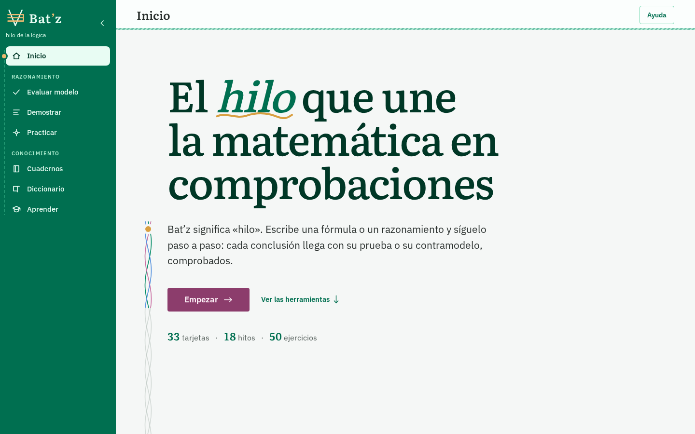
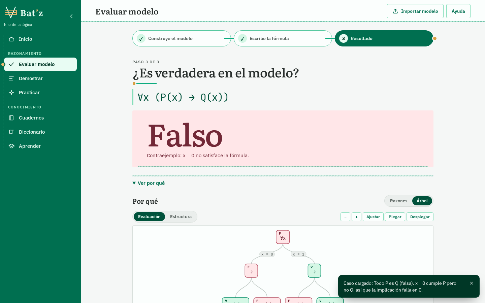
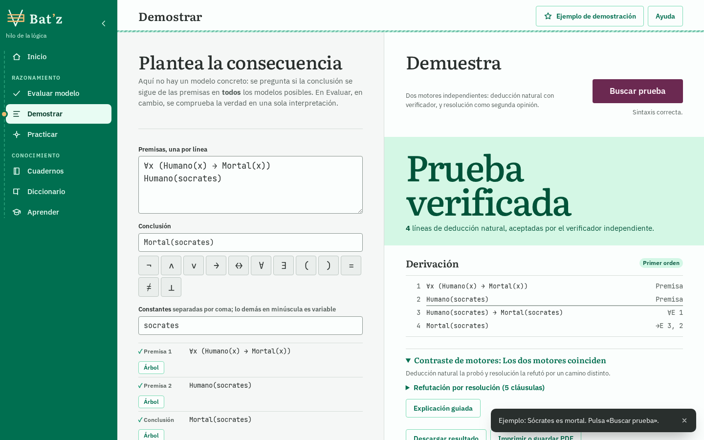
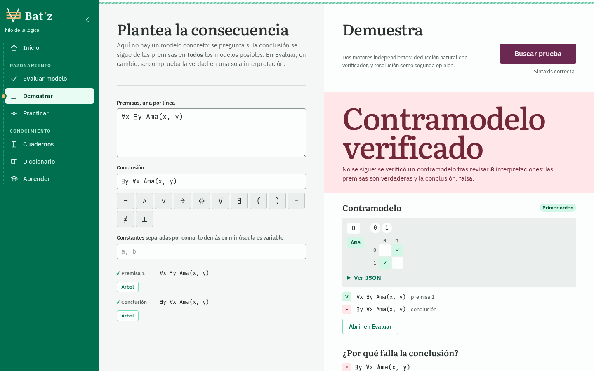
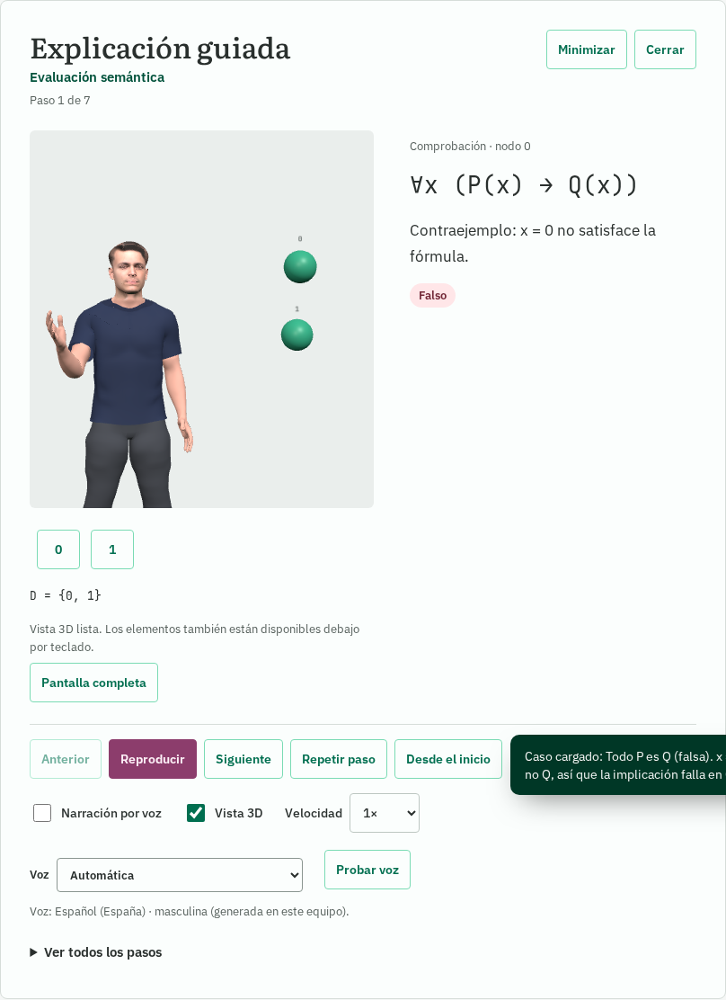
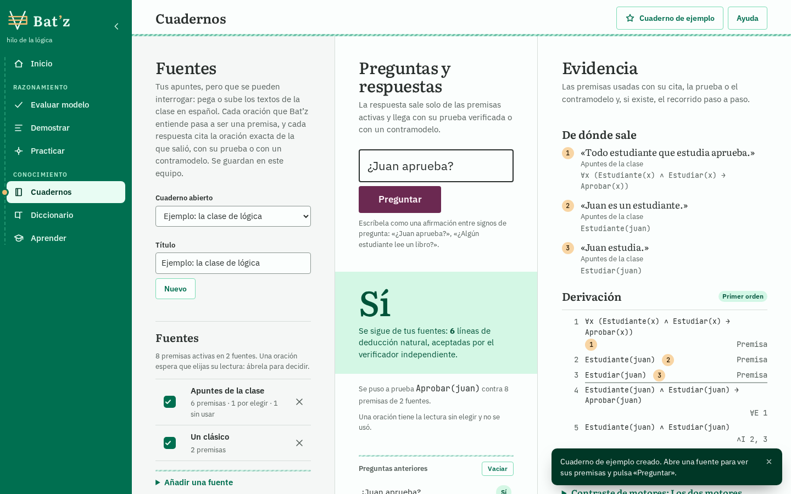
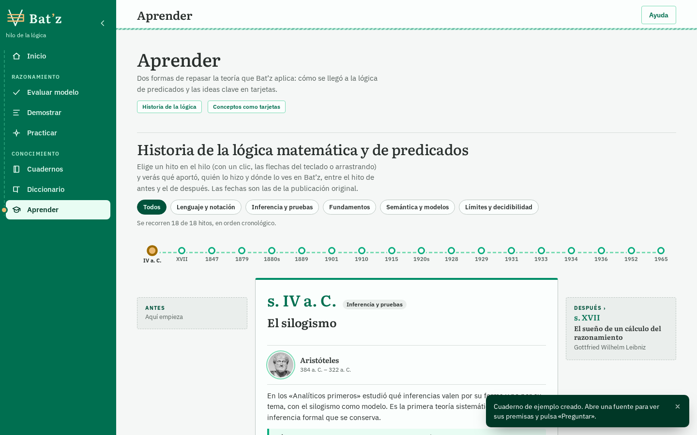

# Bat’z

**Bat’z** («hilo» en k’iche’; antes se llamaba LOGOS) es un laboratorio de lógica de primer orden que corre en tu navegador: evalúa una fórmula en un modelo finito y explica el resultado paso a paso, demuestra consecuencias con pruebas revisadas por un verificador independiente, busca contramodelos y entiende español controlado. Es el proyecto MM3032 («Evaluador semántico»).

Solo necesita la librería estándar de Python; no hay que instalar nada más para revisarlo.



| | |
|---|---|
|  |  |
|  |  |
|  |  |

## Probar en 1 minuto

Tres vías, de la más fácil a la más completa:

1. **Demo en línea (no instala nada).** <!-- DEMO_URL -->https://... — es una demo compartida: puede tardar 30–60 s en despertar y lo que escribas es visible para otras personas (ver [PUBLICAR.md](docs/PUBLICAR.md)).
2. **Docker** (no hace falta Python):

   ```bash
   docker compose up --build        # luego abre http://127.0.0.1:8765
   ```

   Detener con `docker compose down`. Otro puerto: `BATZ_PORT=9000 docker compose up --build`. La imagen incluye `espeak-ng`, así que la voz de la explicación suena sin configurar nada.
3. **Python directamente** (solo librería estándar, **Python 3.10 o posterior**):

   ```bash
   python3 evaluador.py             # abre http://127.0.0.1:8765 en el navegador
   ```

   La versión mínima es 3.10: el código no usa sintaxis posterior (se comprobó analizando todos los `.py` con `ast.parse(..., feature_version=(3, 10))`) ni módulos más recientes de la biblioteca estándar. Se ha ejecutado con Python 3.12 (la imagen de Docker) y 3.14; no se ha probado en una instalación real de 3.10. Para oír la voz en Linux conviene instalar `espeak-ng` (`sudo pacman -S espeak-ng`, `sudo apt install espeak-ng`); sin él, la narración sigue en texto o con las voces del navegador.

## Recorrido de 5 minutos para revisar

El menú de la barra lateral tiene siete secciones. Este recorrido toca todas.

1. **Inicio.** Mira el carrusel de Gödel, Turing y Church y las tarjetas de las herramientas. Si aparece un recorrido de bienvenida, puedes seguirlo u omitirlo.
2. **Evaluar** (menú «Evaluar modelo»). En el paso 1 elige un caso en «¿Prefieres empezar de un caso de ejemplo?»; por ejemplo «Todo P es Q (falsa)», con `D = {0, 1}`, `P = {0}`, `Q = {1}`. Pasa al paso 2, deja `∀x (P(x) → Q(x))` y pulsa **Verificar**. *Qué observar:* el veredicto es **Falso** y la razón es el primer contraejemplo, `x = 0` (cumple `P` y no `Q`). Pulsa «Árbol»: cada nodo trae su valor y bajo cada cuantificador hay una rama por elemento del dominio. Prueba también una entrada inválida (`P(a, a)`): aparece el error con su posición y **ningún** Verdadero/Falso.
3. **Demostrar con tres ejercicios de Gödel y Turing.** En Inicio, en «Practica lo que probaron Gödel y Turing», abre cada tarjeta y pulsa **Buscar prueba**:
   - *Gödel · completitud*: `∀x (Humano(x) → Mortal(x))`, `Humano(socrates) ⊢ Mortal(socrates)`. Sale **Demostrada**, con la prueba en notación de Fitch y, debajo, «Los dos motores coinciden» (deducción natural y resolución, que son independientes).
   - *Tarski y Gödel · modelos*: `∀x ∃y Ama(x, y) ⊢ ∃y ∀x Ama(x, y)`. Sale **No se sigue**, con un contramodelo verificado de dos elementos; «Abrir en Evaluar» lo carga y la conclusión da Falso.
   - *Turing y Church · indecidibilidad*: transitividad, irreflexividad y serialidad de `R` ⊢ `∃x ∀y ¬R(y, x)`. Sale **Búsqueda inconclusa**: no es «falsa» ni «demostrada». Es el límite honesto de un buscador sobre una lógica indecidible.
4. **Cuaderno de ejemplo con cita.** En «Cuadernos» pulsa «Crear el cuaderno de ejemplo», escribe `¿Juan aprueba?` y pulsa «Preguntar». *Qué observar:* la respuesta **Sí** viene con una prueba verificada y tres premisas citadas; al pulsar el número de una cita se abre la fuente en la oración exacta de donde salió. Otras dos oraciones de las fuentes piden elegir lectura o se dejan fuera con su motivo: nada se interpreta «más o menos».
5. **Explicación guiada con avatar y voz opcional.** En el resultado de Evaluar (o de Demostrar) pulsa «Explicación guiada». El avatar 3D señala el elemento que se está probando; un clic en un elemento del dominio salta al caso que el cuantificador prueba con él. Marca «Narración por voz» y elige en «Voz» una del navegador o una de este equipo (espeak-ng); con «Probar voz» la oyes. Hay pantalla completa y Esc para salir.
6. **Aprender y las páginas de Gödel, Turing y Church.** En «Aprender» recorre la línea del tiempo y las tarjetas de teoría (el modo «Estudiar» recuerda cuáles ya sabes). Desde Inicio abre las páginas de **Kurt Gödel**, **Alan Turing** y **Alonzo Church**.
7. **Practicar.** Elige un ejercicio, selecciona una regla, indica las líneas y pulsa «Comprobar paso». El servidor revisa cada paso con el verificador; hay pistas y una solución de referencia. Son 50 ejercicios en tres categorías.

Los argumentos de defensa de cada módulo están en [docs/DEFENSA.md](docs/DEFENSA.md) y la correspondencia punto por punto con el plan, en [docs/REVISION.md](docs/REVISION.md).

## Qué demuestra el proyecto

El plan del proyecto es [`docs/plans/PLAN_MM3032.md`](docs/plans/PLAN_MM3032.md): evaluar fórmulas de primer orden en una interpretación finita, explicarlo y validar las entradas. Sobre eso, Bat’z cuida la **corrección matemática**:

- **El valor lo decide Python, y la explicación sale de una traza ya verificada.** La semántica sigue la definición de Tarski; `check_trace` revisa cada nodo antes de que `explain` o el avatar narren nada. Una entrada inválida nunca produce Verdadero ni Falso.
- **Dos motores independientes para las pruebas.** El motor A busca en deducción natural; el motor B refuta por resolución. Se contrastan, y el B nunca convierte un «no sé» en una prueba.
- **Un verificador separado del buscador.** «Demostrada» solo se muestra si un `checker` que ni siquiera importa el buscador acepta el certificado paso a paso. En lógica proposicional siempre hay veredicto: prueba (con el lema de Kalmár) o valuación que la refuta.
- **Contramodelos verificados.** Un contramodelo se reevalúa con el evaluador antes de mostrarse. Se busca en dominios pequeños (1 a 3 elementos), con límites explícitos de tiempo y candidatos.
- **«Inconcluso» no es «falso» ni «demostrado».** La validez en primer orden es indecidible; si la búsqueda agota sus límites, la respuesta es `unknown` y la interfaz lo rotula como «Búsqueda inconclusa» o, si hay un contramodelo, «No se sigue».
- **Español controlado sin adivinar.** Cada frase da todas sus lecturas (alcance de cuantificadores, sentidos de una palabra) y se elige una; lo que la gramática no entiende se rechaza con su motivo. Ningún modelo de lenguaje decide una fórmula.

Detalle: [semántica](docs/specs/SEMANTICS.md), [cálculo de pruebas](docs/specs/PROOF_CALCULUS.md), [lenguaje formal](docs/specs/FORMAL_LANGUAGE.md), [español controlado](docs/specs/SPANISH_CONTROLLED.md), [reglas de dependencia](docs/architecture/ARCHITECTURE.md) y [contratos JSON](docs/specs/JSON_CONTRACTS.md).

## Pruebas

Solo hace falta Python (y Node para las del frontend). Desde la raíz del repositorio:

```bash
PYTHONPATH=src:tests python3 -m unittest discover -s tests   # 325 pruebas, 1 omitida (unos 40 s)
node --test tests/frontend/app/*.test.mjs                    # 48 pruebas
PYTHONPATH=src python3 scripts/validate_demo.py --seed 20261102   # recorrido reproducible por HTTP local
PYTHONPATH=src python3 scripts/report_spanish.py --check          # los 51 casos del español controlado
```

- **Python (325, 1 omitida).** La omitida es una prueba solo de Windows. Cubre el lexer y el parser, la semántica y las trazas, las explicaciones, la fachada del proyecto con su matriz de errores, el verificador de pruebas y el buscador, la resolución, los contramodelos, el español (con los 51 casos de la especificación), el diccionario, los cuadernos, Practicar, la voz y un servidor HTTP real que sirve la interfaz y la API.
- **Node (48), en `tests/frontend/app/`.** Lógica pura del frontend: rutas, recorrido de bienvenida, tarjetas de estudio, exportación, datos de las personas, elección de voz y que todas las hojas de estilo tengan sus llaves balanceadas.
- **Opcionales de navegador** (requieren Playwright externo, no incluidas en las anteriores): `tests/frontend/player/check.cjs` y `scripts/validate_practice_browser.cjs`.

No hay pruebas automáticas del DOM de `app.js` ni de `practice.js`; esas pantallas se verificaron a mano con un navegador automatizado (ver [Límites](#límites-conocidos)).

## Mapa de documentación

| Documento | Para qué |
|---|---|
| [docs/REVISION.md](docs/REVISION.md) | Requisito del plan → dónde se ve en la app → código → prueba. **Empieza aquí si revisas.** |
| [docs/DEFENSA.md](docs/DEFENSA.md) | Cada módulo y la regla matemática que implementa; 15 preguntas probables con su respuesta. |
| [docs/plans/PLAN_MM3032.md](docs/plans/PLAN_MM3032.md) | Plan vigente: requisitos, estado y decisiones. |
| [docs/USO.md](docs/USO.md) | Guía de uso detallada: API de Python, cada pantalla, formatos de archivo, voz opcional. |
| [docs/PUBLICAR.md](docs/PUBLICAR.md) | Docker local, hosting gratuito (Render, Hugging Face) y por qué no Vercel. |
| [docs/ARQUITECTURA.md](docs/ARQUITECTURA.md) | Resumen técnico completo y verificado del código, con límites y deuda. |
| [docs/architecture/ARCHITECTURE.md](docs/architecture/ARCHITECTURE.md) | Diseño: flujo de datos, módulos, reglas de dependencia, dos caminos de prueba. |
| [docs/specs/JSON_CONTRACTS.md](docs/specs/JSON_CONTRACTS.md) | Contratos JSON de la API local. Otras especificaciones: [lenguaje](docs/specs/FORMAL_LANGUAGE.md), [semántica](docs/specs/SEMANTICS.md), [pruebas](docs/specs/PROOF_CALCULUS.md), [español](docs/specs/SPANISH_CONTROLLED.md), [reproductor](docs/specs/EXPLANATION_PLAYER.md). |
| [docs/validation/ENSAYO-MM3032.md](docs/validation/ENSAYO-MM3032.md) | Ensayos: recorrido reproducible, [51 casos de español](docs/validation/ESPANOL-51-CASOS.md), [auditoría del léxico](docs/validation/LEXICO-AUDITORIA.md) y [lo que falta por revisar](docs/validation/REVISION-EQUIPO.md). |
| [docs/plans/entregas/INTEGRACION.md](docs/plans/entregas/INTEGRACION.md) | Rediseño de la interfaz: [plan](docs/plans/REDISENO_INTERFAZ.md), [reparto](docs/plans/REDISENO_PARALELO.md) e integración. El plan original de implementación: [IMPLEMENTATION_PLAN.md](docs/plans/IMPLEMENTATION_PLAN.md). |
| [AGENTS.md](AGENTS.md) | Instrucciones para agentes de código que trabajen en el repositorio. |
| [docs/00-README-ROADMAP.md](docs/00-README-ROADMAP.md) y fases `01`–`10` | Documentos de planificación originales (históricos). |

## Créditos

- **Fotos y retratos** de Inicio, Aprender y las páginas de personas: copias locales con autor, licencia y origen verificados en [`src/batz/web/img/CREDITOS.md`](src/batz/web/img/CREDITOS.md). Los de licencia CC BY-SA muestran su crédito junto a la imagen.
- **Bibliotecas, tipografías y avatar** (Three.js, Literata, IBM Plex Sans, JetBrains Mono, Human Base Meshes, MediaPipe, whisper.cpp) con sus licencias y procedencia: [`docs/THIRD_PARTY.md`](docs/THIRD_PARTY.md). La textura del rostro del avatar sale de fotos de un integrante del equipo, usadas con su permiso.
- Las microinteracciones se inspiraron en componentes de 21st.dev y están reescritas a mano, sin dependencias.

## Límites conocidos

Dicho con franqueza, para que no sorprenda en una revisión:

- **La validez en primer orden es indecidible.** El buscador de pruebas es incompleto por diseño (profundidad 6, 20 000 nodos, 3 s); los contramodelos se buscan solo hasta 3 elementos. «Búsqueda inconclusa» es una respuesta legítima. En lógica proposicional (letras como `p → q`) siempre hay veredicto hasta 12 letras (la prueba de Kalmár, hasta 6).
- **Evaluar usa el perfil estricto del proyecto**: dominio no vacío, relaciones no vacías y predicados de aridad ≥ 1. Un contramodelo de Demostrar puede tener una relación vacía (semántica clásica) y entonces no se puede abrir en Evaluar; la interfaz lo dice.
- **El diccionario del español lo generó un asistente y no tiene revisión humana** (unas 6200 entradas más unas 2700 formas deducidas por reglas). Está auditado automáticamente (0 avisos de confianza alta), pero una persona debe confirmarlo. El español controlado cubre un fragmento, no el español en general.
- **Lo que necesita personas sigue pendiente** ([`docs/validation/REVISION-EQUIPO.md`](docs/validation/REVISION-EQUIPO.md)): revisión cruzada firmada, ensayo de defensa, ensayo audible con una voz española real, prueba en un teléfono real y la fecha de entrega.
- **Sin pruebas automáticas del DOM** (`app.js` tiene unas 2300 líneas en un solo módulo). La interfaz se probó a mano con Chromium automatizado a distintos anchos; teléfono real y lector de pantalla real no se probaron.
- **La voz** de `espeak-ng` es sintética y robótica; la transcripción por voz (whisper.cpp) es opcional, no está en Docker y su instalador para Linux/macOS no se ha probado en un sistema real.
- **Seguridad: es una aplicación local.** El servidor no tiene autenticación ni comprueba `Origin`/`Host`; escucha en `127.0.0.1` por defecto. En la demo pública el estado (cuadernos, palabras añadidas) es compartido entre visitantes y se pierde al reiniciar: no escribas datos personales.
- **La escena 3D** admite dominios de hasta 12 elementos; con más, queda el texto y la vista 2D.
- Algunas fechas y atribuciones históricas de «Aprender» no se contrastaron con fuentes externas.
